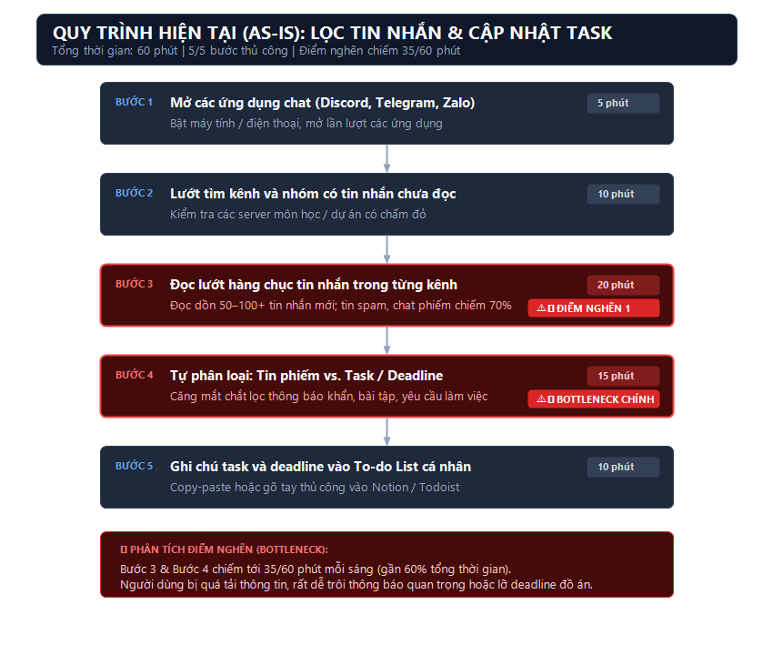
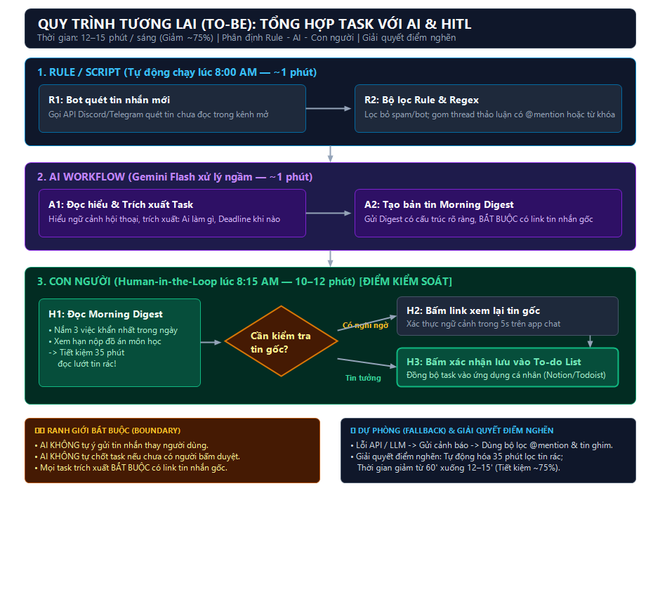

# Báo cáo nhóm - Day 02 Discovery & Problem Framing

## 1. Thông tin nhóm

- Tên nhóm: SieuBaKhi
- Thành viên: Đặng Đức Minh (2A202603886), Phạm Quốc Huy (2A202603897) - xem `TEAM.md`
- Candidate problem được chọn (1 câu): Lọc và tổng hợp thông tin quan trọng / task cần làm từ các kênh chat nhóm dự án vào mỗi sáng để tránh trôi deadline và tiết kiệm thời gian đọc tin.
- Quyết định cuối: Go / Not Yet / No-Go

---

## 2. Hội tụ nhóm (CP3)

### 2.1. Pitch

| # | Người đưa ra | Candidate (Job Story ngắn) | Actor | Bottleneck | Câu hỏi phản biện nhận được (ai hỏi) |
|---:|---|---|---|---|---|
| 1 | Đặng Đức Minh | Khi bắt đầu ngày làm việc/học tập với hàng chục tin nhắn trên Zalo, Discord, Telegram, tôi muốn lọc nhanh các tin nhắn quan trọng và task cần xử lý, để không bỏ lỡ hạn chót hoặc thông báo khẩn | Sinh viên, quản lý dự án, người dùng nhiều ứng dụng chat | Đọc và tự lọc tin quan trọng (40–60 phút/ngày) | Huy hỏi: "Các nền tảng như Zalo/Telegram cá nhân có chính sách bảo mật API rất khắt khe, làm sao công cụ có thể đọc được tin nhắn mà không vi phạm quyền riêng tư?" |
| 2 | Đặng Đức Minh | Khi clone một repo dự án mới về máy cá nhân, tôi muốn cài đặt đúng và đủ các dependencies/configurations tương thích với hệ điều hành, để bắt tay vào chạy và test mã nguồn ngay mà không bị lỗi môi trường | Lập trình viên mới vào dự án, sinh viên làm bài tập lớn | Debug lỗi môi trường và xung đột thư viện (45–120 phút) | Huy hỏi: "Nếu dự án đã đóng gói sẵn bằng Docker hoặc viết script setup tự động thì việc cài đặt chỉ mất vài phút, có thật sự cần đến AI không?" |
| 3 | Đặng Đức Minh | Khi hoàn thành một đợt phát triển tính năng (sprint) hoặc chuẩn bị nộp bài tập lớn, tôi muốn tổng hợp nhanh danh sách thay đổi và cập nhật tài liệu kỹ thuật, để các thành viên khác hiểu code và nghiệm thu dễ dàng | Trưởng nhóm kỹ thuật, thành viên làm đồ án | Đọc lại commit và tự viết narrative/tài liệu (60–120 phút) | Huy hỏi: "Nếu commit message trong nhóm viết sơ sài kiểu 'fix bug', 'update', AI dựa vào đâu để hiểu đúng logic thay đổi mà viết document?" |
| 4 | Phạm Quốc Huy | Khi ôn lại bài cũ sau buổi học hoặc trước khi làm lab, tôi muốn tóm tắt và đọc lại những gì đã được học từ slide và ghi chép, để ôn lại kiến thức và thực hành hiệu quả | Học viên, sinh viên học công nghệ/AI | Đọc lại slide, chọn lọc kiến thức và viết bản tóm tắt (khoảng 70 phút) | Minh hỏi: "Làm sao để biết bản tóm tắt của AI là chính xác, không bịa kiến thức (hallucination) mà người học không phải mất công đọc lại slide gốc để đối chiếu?" |
| 5 | Phạm Quốc Huy | Khi thức dậy vào buổi sáng, tôi muốn nắm bắt nhanh nội dung các cuộc trò chuyện trong nhóm chat, để không bỏ lỡ những thông tin quan trọng và deadline | Thành viên trong các nhóm chat học tập/dự án | Đọc lại các tin nhắn chưa xem để tìm việc quan trọng (khoảng 10 phút) | Minh hỏi: "Nếu mỗi người chỉ tham gia 1-2 nhóm chat và mất 10 phút lướt đọc, liệu vấn đề này có đủ lớn và cấp bách để cần xây giải pháp riêng không?" |
| 6 | Phạm Quốc Huy | Khi mở lại máy để tiếp tục dự án, tôi muốn tự động khôi phục đúng các ứng dụng, terminal, tab tài liệu liên quan, để tiếp tục làm việc mà không mất công tìm lại vị trí làm dở | Lập trình viên, người làm nhiều dự án cùng lúc | Tìm lại tài liệu, tab trình duyệt và xác định vị trí công việc dở dang (khoảng 5 phút) | Minh hỏi: "Tính năng khôi phục phiên làm việc (Restore Session) của VS Code và trình duyệt đã hỗ trợ việc này, liệu một script tự động có giải quyết triệt để hơn không?" |

### 2.2. Cluster

| Cluster | Các candidate | Pattern chung |
|---|---|---|
| A - Quản lý thông tin & tin nhắn giao tiếp nhóm | Candidate #1 (Minh) & Candidate #5 (Huy) | Quá tải thông tin từ các kênh chat; tin nhắn công việc quan trọng/deadline bị trôi giữa các tin nhắn rác hoặc chat phiếm, tốn thời gian rà soát thủ công mỗi sáng |
| B - Khôi phục & thiết lập môi trường làm việc kỹ thuật | Candidate #2 (Minh) & Candidate #6 (Huy) | Tiêu tốn thời gian chết (overhead) khi bắt đầu làm việc; phải cấu hình thủ công dependencies, extension hoặc mở lại nhiều tab/công cụ rời rạc |
| C - Xử lý và tổng hợp tri thức / tài liệu dự án | Candidate #3 (Minh) & Candidate #4 (Huy) | Phải đọc và xâu chuỗi lượng lớn dữ liệu thô (commit/code diff hoặc slide bài giảng) rồi tự tổng hợp thành văn bản có cấu trúc cho bản thân hoặc người khác đọc |

### 2.3. Opportunity Solution Tree rút gọn

Gốc là **1 outcome**. Nhánh là **opportunity** (nhu cầu, pain), không phải tính năng hay công cụ.

```text
OUTCOME: Giảm thời gian sinh viên/thành viên dự án tiêu tốn để nắm bắt thông tin quan trọng trong các kênh chat nhóm mà không bỏ sót deadline/task khẩn
├── Opportunity A: Tin nhắn quan trọng (deadline, nộp bài, task khẩn) bị trôi lẫn giữa hàng chục/hàng trăm tin nhắn chat phiếm và spam trong các kênh nhóm
├── Opportunity B: Các cuộc thảo luận và quyết định công việc kéo dài qua nhiều tin nhắn rời rạc, tốn thời gian lội lại thread để nắm được ai cần làm gì
└── Opportunity C: Thành viên lo ngại bị bỏ sót việc nhưng không có đủ thời gian mở và đọc từng kênh chat mỗi sáng
```

Những ý đã gạch bỏ vì là solution đội lốt opportunity:

- ✗ "Xây dựng Bot AI tự động đọc và tóm tắt tin nhắn" (Đây là giải pháp công nghệ/tính năng, không phải nhu cầu của người dùng)
- ✗ "Tạo một web dashboard tập trung hiển thị thông báo từ tất cả các app chat" (Đây là tính năng sản phẩm)
- ✗ "Tự động gửi email tổng hợp tin nhắn mỗi sáng" (Đây là cơ chế phân phối/tính năng của giải pháp)
- ✗ "Tạo chatbot tự động trả lời và nhắc việc" (Đây là giải pháp AI trá hình)

### 2.4. Chấm điểm shortlist (1–5)

| Candidate | Actor rõ | Quy trình rõ | Pain có bằng chứng | Impact đo được | Vừa sức lab | So sánh được No AI/Rule/Workflow/Agent | Nhóm hiểu domain | Tổng |
|---|---:|---:|---:|---:|---:|---:|---:|---:|
| Candidate #1: Lọc & tổng hợp tin nhắn nhóm (Minh) | 5 | 5 | 5 | 5 | 4 | 5 | 5 | **34** |
| Candidate #4: Tổng hợp kiến thức ôn bài từ slide (Huy) | 5 | 4 | 4 | 3 | 4 | 3 | 5 | **28** |
| Candidate #6: Khôi phục workspace dự án khi mở máy (Huy) | 5 | 5 | 4 | 4 | 5 | 2 | 5 | **30** |

**Candidate được chọn:**
Candidate #1 - Lọc và tổng hợp thông tin quan trọng / task cần làm từ các kênh chat nhóm làm việc/dự án vào mỗi sáng.

**Vì sao chọn:**
1. Đạt điểm cao nhất (34/35) trên 7 tiêu chí đánh giá khách quan.
2. Nỗi đau có thật và diễn ra đều đặn hằng ngày (mỗi sáng), cả 2 thành viên trong nhóm đều gặp và có sự đồng thuận cao (độc lập đưa ra ở CP1 & CP2).
3. Quy trình hiện tại rất rõ ràng (5 bước), baseline đo lường được bằng thời gian thực tế (từ 40–60 phút/ngày).
4. Phân tầng công nghệ cực kỳ rõ ràng giữa 4 mức No AI (quy ước tag/ghim) / Rule (lọc keyword/mention) / Workflow (rule gom tin + AI tóm tắt action items) / Agent (AI tự trả lời/giao việc) mà không bị khiên cưỡng.

**Vì sao loại các candidate còn lại:**
- **Loại Candidate #6 (Khôi phục workspace dự án):** Quy trình và actor rất rõ, nhưng bản chất bài toán là **Rule / Script**. Chỉ cần dùng tính năng Session Restore của trình duyệt/VS Code hoặc viết một file script tự động (`.bat`/`.sh`) là giải quyết được 90% vấn đề, không cần đến AI; nếu đưa AI vào sẽ là lạm dụng công nghệ (AI-first).
- **Loại Candidate #4 (Tổng hợp kiến thức ôn bài từ slide):** Mặc dù tốn nhiều thời gian (1–2 tiếng), nhưng thị trường đã có công cụ giải quyết quá tốt (Google NotebookLM hoàn toàn miễn phí và trích dẫn chuẩn). Đồng thời, nhóm gặp khó khăn lớn trong việc đo lường độ chính xác của bản tóm tắt và nguy cơ AI bịa đặt kiến thức (hallucination) khiến người học vẫn phải đọc lại toàn bộ slide gốc để kiểm tra.

**Xử lý bất đồng (nếu có):**
Ban đầu Huy muốn chọn Candidate #4 vì thời gian bỏ ra lớn (1–2 tiếng/lần ôn). Minh phản biện rằng bài toán tóm tắt bài học rất khó đánh giá chất lượng (eval) và Google NotebookLM đã làm gần như hoàn hảo. Sau khi đối chiếu bảng chấm điểm 7 tiêu chí, cả hai thống nhất chọn Candidate #1 vì tính khả thi cao hơn, có metric đo lường tốc độ & độ chính xác cụ thể, và cả hai đều trực tiếp trải nghiệm nỗi đau này mỗi ngày.

---

## 3. Kiểm chứng + research giải pháp đã có (CP4)

### 3.1. Assumption Map

| # | Giả định | Loại (Value / Usability / Feasibility / Viability) | Quan trọng (1–5) | Đã có bằng chứng (1–5) | Kiểm chứng trước? |
|---:|---|---|---:|---:|---|
| 1 | Sinh viên và thành viên dự án khác cũng mất 30–60 phút mỗi sáng để đọc và lọc tin nhắn trong các kênh nhóm | Value | 5 | 3 | ✅ |
| 2 | Người dùng quan tâm nhất là không bỏ sót Deadline và Action Item khẩn, hơn là đọc tóm tắt nội dung chat phiếm | Value | 5 | 4 | ✅ |
| 3 | Người dùng sẵn sàng tin tưởng bản tóm tắt Action Items từ AI nếu có trích dẫn/link dẫn tới tin nhắn gốc để đối chiếu | Usability | 4 | 2 | ✅ |
| 4 | Nền tảng Discord và Telegram hỗ trợ Bot API/Webhook đọc tin nhắn trong kênh nhóm làm việc công khai | Feasibility | 5 | 5 | - |
| 5 | Thành viên trong nhóm làm việc đồng ý cho Bot tham gia kênh dự án mà không lo ngại vi phạm quyền riêng tư | Viability | 4 | 2 | ✅ |

*Điền 4–6 giả định; xóa dòng thừa.*

Giả định nhóm kiểm chứng trong buổi này: Giả định #1, #2, #3 và #5 (kiểm chứng thông qua phỏng vấn người thật theo The Mom Test).

### 3.2. Kiểm chứng

Cách đã dùng: Phỏng vấn nhanh 2 người thật (Trưởng nhóm đồ án và học viên cùng khóa) theo 3 luật của The Mom Test.

Interview snapshot #1:

| Trường | Nội dung |
|---|---|
| Người được hỏi (vai trò, không ghi tên thật) | Trưởng nhóm đồ án môn học (sinh viên năm cuối, quản lý server Discord 6 thành viên) |
| Câu nói đáng nhớ nhất (nguyên văn) | "Sáng nào mở mắt ra cũng thấy 50+ tin nhắn mới trong server, sợ nhất là ai đó tag deadline nộp bài giữa đống tin nhắn đùa mà mình trôi mất." |
| Lần gần nhất gặp vấn đề này: chuyện gì đã xảy ra? | Sáng thứ Năm tuần trước, một bạn nộp link Figma lúc 1h sáng trong kênh general, cả nhóm không để ý khiến sáng hôm sau trễ giờ nộp bài tiến độ cho giảng viên. |
| Hiện đang xử lý bằng cách nào (workaround)? | Phải ghim (pin) tin nhắn thủ công hoặc nhắc nhau qua Zalo cá nhân; ai online trước thì tag người khác vào nhắc. |
| Mất bao lâu, bao lần? | 30–45 phút mỗi sáng lướt qua 4 kênh khác nhau (general, dev, design, meeting). |
| Insight / opportunity rút ra | Nhu cầu cốt lõi không phải là đọc hết mọi tin nhắn, mà là cần danh sách rõ ràng: Ai giao việc gì, hạn chót khi nào, link tài liệu ở đâu. |

Interview snapshot #2:

| Trường | Nội dung |
|---|---|
| Người được hỏi (vai trò, không ghi tên thật) | Học viên lớp AI thực chiến (tham gia 3 nhóm chat Zalo/Telegram làm lab) |
| Câu nói đáng nhớ nhất (nguyên văn) | "Tin nhắn chat phiếm thì nhiều, lướt qua thì mất thời gian, mà tắt thông báo thì lại sợ sót tin thầy dặn đổi lịch hay hạn nộp." |
| Lần gần nhất gặp vấn đề này: chuyện gì đã xảy ra? | Tuần trước không đọc kịp thông báo đổi phòng học và bổ sung file rubric vì tin nhắn bị đẩy trôi qua 100 tin nhắn thảo luận bài tập khác. |
| Hiện đang xử lý bằng cách nào (workaround)? | Bật chế độ "Mention only", nhưng nhiều khi bạn bè hỏi việc chung không tag tên trực tiếp nên vẫn bị trôi. |
| Mất bao lâu, bao lần? | 15–20 phút/ngày, lặp lại mỗi sáng và mỗi tối. |
| Insight / opportunity rút ra | Chế độ Mention only (No AI / Rule) vẫn bỏ sót các thông báo quan trọng mang tính chất chung. Cần một bản tóm tắt trích xuất thông báo chung + task cá nhân. |

Tổng hợp:

| Nguồn | Số người / số mẫu | Tín hiệu xác nhận | Tín hiệu phản bác |
|---|---:|---|---|
| Phỏng vấn trực tiếp | 2 | 2/2 người xác nhận mất 20–45 phút/ngày để lọc tin nhắn và đều từng bị trôi deadline/thông báo quan trọng ít nhất 1 lần trong 2 tuần qua. Cả hai khẳng định chỉ cần AI trích xuất đúng Action Items và có trích dẫn nguồn tin nhắn để đối chiếu là sẵn sàng sử dụng. | 1 người cho biết nếu nhóm có quy ước chặt chẽ (luôn tag `@everyone` và ghim tin quan trọng) thì Rule/thói quen thủ công đã giải quyết được 60–70% vấn đề, không nhất thiết phải tóm tắt các đoạn chat phiếm. |

**Nhóm đã sửa problem thế nào sau kiểm chứng:**
1. **Thu hẹp phạm vi:** Không cố gắng tóm tắt toàn bộ mọi đoạn hội thoại rườm rà, mà tập trung chuyên biệt vào việc **trích xuất Action Items (Ai làm gì, trước mấy giờ) và cảnh báo Deadline từ các thread thảo luận dài**.
2. **Bổ sung yêu cầu thiết kế bắt buộc:** Mọi task/deadline được AI trích xuất **bắt buộc phải kèm trích dẫn hoặc link dẫn tới tin nhắn gốc** để người dùng có thể nhấp vào đối chiếu ngay lập tức, giải quyết triệt để rủi ro người dùng không dám tin tưởng bản tóm tắt (Usability & Hallucination).

### 3.3. Research giải pháp đã có

| Công cụ / case / pattern | Link | Giải bước nào trong quy trình? | Điểm mạnh | Khoảng trống / rủi ro | Bài học cho nhóm |
|---|---|---|---|---|---|
| Slack AI (In-Channel Recap & Summaries) | https://slack.com/help/articles/25076892548883-Guide-to-AI-features-in-Slack | Tóm tắt kênh, thread và recap hằng ngày tự động | Tích hợp sâu, giao diện mượt, bảo mật dữ liệu cấp doanh nghiệp, có trích dẫn nguồn tin gốc | Chi phí rất đắt (chỉ dành cho gói Enterprise/Business+ kèm add-on trả phí), chỉ hỗ trợ Slack, chưa trích xuất danh sách Action Items riêng | Nhóm không tự xây mô hình tóm tắt; nhưng cần làm công cụ hướng tới sinh viên/nhóm nhỏ trên Discord/Telegram và tập trung vào trích xuất Action Items thay vì tóm tắt chung chung |
| Discord Conversation Summaries (Official Blog Announcement) | https://discord.com/blog/ai-on-discord-your-place-for-ai-with-friends | Phân nhóm tin nhắn theo chủ đề (topic) và hiển thị tóm tắt ngắn ở đầu kênh | Được tích hợp trực tiếp trên nền tảng Discord, hiển thị người tham gia và trích đoạn xem trước | Tính năng thử nghiệm bị giới hạn cho một số server; không có tính năng tự động trích xuất deadline/task; không tổng hợp xuyên kênh | Người dùng cần bản tổng hợp tập trung vào Deadline & Task đầu ngày, chứ không chỉ là danh sách chủ đề chat |
| Telegram Group Chat Summarizer Bot (Open-source pattern) | https://github.com/moalimir/Telegram-Group-Chat-Summarizer-Bot | Đọc lịch sử tin nhắn nhóm qua Bot API và tóm tắt theo yêu cầu bằng Gemini API | Mã nguồn mở, chi phí cực thấp (dùng Gemini Flash API), dễ cắm vào group Telegram làm đồ án | Phải gọi lệnh thủ công (`/summarize`), chưa có cơ chế tự động gửi digest đầu ngày; phụ thuộc vào cấu hình Privacy Mode của bot | Học hỏi pattern kiến trúc: Telegram Bot API + LLM API, nhưng nâng cấp thành Workflow tự động chạy định kỳ lúc 8h sáng với output có cấu trúc rõ ràng |

---

## 4. Quy trình trước/sau (CP5)

### 4.1. Quy trình hiện tại



```text
HIỆN TẠI - 5 bước, 60 phút, 5/5 bước thủ công:

[1. Mở app chat: 5'] → [2. Lướt tìm kênh có tin mới: 10']
→ [3. Đọc lướt hàng chục tin: 20'] ← BOTTLENECK (20 phút)
→ [4. Tự lọc tin quan trọng & deadline: 15'] ← BOTTLENECK CHÍNH (15 phút)
→ [5. Ghi chú task vào to-do list: 10']
```

| Bước | Actor | Input | Output | Thời gian / tần suất | Ghi chú |
|---:|---|---|---|---|---|
| 1 | Sinh viên / Thành viên nhóm | Mở máy tính / điện thoại | Ứng dụng chat đã sẵn sàng | 5 phút / mỗi sáng | Thường mở 2–3 ứng dụng khác nhau (Discord, Telegram, Zalo) |
| 2 | Sinh viên / Thành viên nhóm | Danh sách server / group chat | Xác định các kênh có chấm đỏ / badge tin nhắn mới | 10 phút / mỗi sáng | Kênh làm việc và kênh chat phiếm nằm lẫn lộn |
| 3 | Sinh viên / Thành viên nhóm | Lịch sử tin nhắn chưa đọc (50–100+ tin nhắn) | Đọc qua toàn bộ nội dung hội thoại | 20 phút / mỗi sáng | Rất mỏi mắt, tin nhắn spam/meme chiếm 70% |
| 4 | Sinh viên / Thành viên nhóm | Nội dung tin nhắn đã đọc | Tách biệt được đâu là thông báo khẩn/task/deadline | 15 phút / mỗi sáng | **BOTTLENECK CHÍNH**: Dễ bị trôi tin nhắn bàn việc nếu nằm kẹp giữa các tin nhắn đùa |
| 5 | Sinh viên / Thành viên nhóm | Danh sách task/deadline vừa nhận diện | To-do list / ghi chú cá nhân được cập nhật | 10 phút / mỗi sáng | Thao tác copy-paste hoặc gõ tay thủ công |

**Bottleneck chính:**
Bước 3 & Bước 4 (Đọc lướt và tự lọc thông tin quan trọng): Chiếm **35/60 phút** mỗi sáng. Người dùng phải tiêu tốn tải nhận thức (cognitive load) lớn chỉ để sàng lọc thông tin rác nhằm tìm ra 1–2 thông báo quan trọng. Nếu lướt nhanh thì bỏ sót việc, nếu đọc kỹ thì mất cả tiếng đồng hồ đầu ngày.

### 4.2. Quy trình tương lai



```text
TƯƠNG LAI - 3 bước, khoảng 12–15 phút, 1/3 bước thủ công:

[1. Bot quét tin tự động: 1']           ← RULE / SCRIPT
→ [2. LLM trích xuất Action Items: 1']   ← AI WORKFLOW
→ [3. Người dùng đọc & duyệt task: 10']  ← CON NGƯỜI (HITL)

BOUNDARY: AI không tự gửi tin nhắn, không tự duyệt task.
FALLBACK: Bot/LLM lỗi → người dùng dùng bộ lọc Mention only và Pinned messages thủ công.
```

Phân định rõ trách nhiệm trong quy trình tương lai:

- **Bước 1 - Rule / Script (Tự động chạy lúc 8:00 AM - 1 phút):** Script/Bot tự động kích hoạt theo lịch, gọi Bot API (Discord / Telegram) để lấy các tin nhắn chưa đọc trong các kênh dự án được chỉ định (Rule lọc bỏ tin nhắn hệ thống, tin nhắn từ bot khác).
- **Bước 2 - AI Workflow (LLM xử lý - 1 phút):** Mô hình ngôn ngữ (Gemini Flash) tiếp nhận chuỗi hội thoại, nhận diện các câu thảo luận có tính cam kết hoặc phân công, trích xuất ra cấu trúc: `[Deadline] - [Người phụ trách] - [Nội dung việc cần làm] - [Link trích dẫn tin nhắn gốc]`, định dạng thành bản tin **Morning Digest**.
- **Bước 3 - Con người kiểm tra & duyệt (Human-in-the-Loop - 10–12 phút):** Người dùng thức dậy mở xem bản Digest; nhấp vào link đối chiếu lại ngữ cảnh đối với các task khẩn cấp; bấm xác nhận để đồng bộ task vào to-do list cá nhân.

**Boundary (Ranh giới bắt buộc):**
- AI **tuyệt đối KHÔNG** tự ý gửi tin nhắn trả lời thay người dùng trong các nhóm chat.
- AI **tuyệt đối KHÔNG** tự ý tạo hoặc chỉnh sửa task trong to-do list nếu người dùng chưa bấm duyệt.
- AI chỉ hoạt động trong phạm vi các kênh nhóm văn bản được phân quyền rõ ràng, không được đọc tin nhắn riêng tư (DM).
- Mọi Action Item được AI tạo ra **bắt buộc phải kèm trích dẫn hoặc link dẫn tới tin nhắn gốc**.

**Phương án quay về (Fallback):**
- Nếu Bot API gặp sự cố mất mạng hoặc LLM bị lỗi kết nối/rate limit $\rightarrow$ Hệ thống lập tức gửi thông báo ngắn *"Chưa thể tạo digest sáng nay"*; người dùng quay về cách xử lý thủ công bằng cách sử dụng bộ lọc "Mention only" và xem mục Pinned Messages trên ứng dụng chat như trước đây.

### 4.3. Before / after

| Chỉ số | Trước (As-Is) | Sau (To-Be kỳ vọng) | Ghi chú |
|---|---:|---:|---|
| **Số bước** | 5 bước thủ công | 3 bước lớn (Rule $\rightarrow$ AI $\rightarrow$ Người duyệt) | Giảm thiểu thao tác chuyển qua lại giữa nhiều app/kênh |
| **Tổng thời gian** | 60 phút/ngày | Khoảng 12–15 phút/ngày | Tiết kiệm ~75% thời gian đầu ngày |
| **Số bước thủ công** | 5/5 bước | 1/3 bước (chỉ còn bước người đọc và duyệt) | Máy làm phần sàng lọc dữ liệu thô, người kiểm soát chất lượng |
| **Bottleneck chính** | Đọc lướt và tự lọc tin nhắn rác | Người kiểm tra đối chiếu tin nhắn gốc | Bottleneck mới tập trung vào khâu kiểm soát chất lượng, an toàn hơn |
| **Rủi ro mới phát sinh** | Không có (chỉ tốn công sức) | AI có thể trích xuất thiếu task hoặc hiểu nhầm câu nói đùa thành deadline | Kiểm soát chặt chẽ bằng: trích dẫn link tin nhắn gốc + con người bấm duyệt |

---

## 5. Problem Statement v0 (CP5)

| Trường | Nội dung |
|---|---|
| **Actor** | Sinh viên năm cuối, học viên các khóa công nghệ, và người tham gia nhiều nhóm dự án học tập/làm việc trên Discord/Telegram |
| **Quy trình** | Mỗi buổi sáng: mở ứng dụng chat $\rightarrow$ lướt tìm các nhóm có tin mới $\rightarrow$ đọc lướt qua hàng chục tin nhắn $\rightarrow$ tự lọc tin nhắn quan trọng và deadline $\rightarrow$ ghi chú task cần làm |
| **Bottleneck** | Phải đọc lướt qua lượng lớn tin nhắn rác, chat phiếm và spam để tìm thông báo công việc (mất 35–45 phút/ngày), gây mệt mỏi và dễ trôi tin |
| **Impact** | Tốn 45–60 phút mỗi sáng; từng bị trễ hạn nộp đồ án/bài tập nhóm ít nhất 1 lần/tháng; tâm lý căng thẳng sợ bỏ sót việc khẩn cấp |
| **Success Metric** | (1) Tổng thời gian rà soát và cập nhật task đầu ngày giảm từ 60 phút xuống dưới 15 phút (đo bằng nhật ký tự ghi thời gian trong 2 tuần pilot); (2) Tỉ lệ bỏ sót deadline/task có phân công cụ thể bằng 0% |
| **Boundary** | AI không được tự ý gửi tin nhắn thay người dùng; không tự ý tạo hay sửa task nếu người dùng chưa bấm duyệt; không can thiệp vào tin nhắn riêng tư (DM); mọi task trích xuất bắt buộc phải có link trích dẫn tin nhắn gốc để con người kiểm tra (HITL) |

**Phản biện nhận được (từ AI đóng vai PM hoài nghi) và nhóm có đồng ý không:**

- *Phản biện của AI:* "Success Metric giảm thời gian xuống dưới 15 phút là rất tốt, nhưng nếu người dùng vì tin tưởng bản tóm tắt mà không bấm vào link gốc để kiểm tra, dẫn đến việc AI bỏ sót một deadline quan trọng mà họ không biết thì sao?"
- *Nhóm đồng ý và xử lý:* Bổ sung cơ chế ưu tiên: Đối với các tin nhắn có nhắc tên trực tiếp (@mention) hoặc chứa các từ khóa khẩn cấp (*"hôm nay"*, *"gấp"*, *"trước 12h"*), hệ thống sẽ đánh dấu màu đỏ (High Priority) và bắt buộc người dùng bấm vào xác nhận đã đọc trước khi lưu.

---

## 6. Mức can thiệp AI (CP6)

### 6.1. Ma trận độ mơ hồ × độ phức tạp

Bài của nhóm nằm ở ô: **Độ mơ hồ cao (High Ambiguity) × Độ phức tạp quy trình thấp-trung bình (Low-to-Medium Complexity)** $\rightarrow$ Giải pháp tối ưu: **Workflow with AI** (Quy trình tự động hóa có mắt xích xử lý ngôn ngữ bằng AI).

Vì sao:
- **Độ mơ hồ cao (High Ambiguity):** Dữ liệu đầu vào là các đoạn hội thoại tự nhiên trong nhóm chat sinh viên, sử dụng nhiều tiếng lóng, từ ngữ viết tắt (*"deadline t6 nha ae"*, *"Minh push code trc 12h hộ t"*, *"slide xong chưa mng"*), xen kẽ giữa tin nhắn bàn việc và tin đùa giỡn, spam, gửi meme. Không có một bộ từ khóa tĩnh nào có thể bao quát hết ngữ cảnh giao tiếp đời thực để phân biệt đâu là cam kết công việc và đâu là tán gẫu.
- **Độ phức tạp quy trình thấp-trung bình (Low-to-Medium Complexity):** Quy trình xử lý hoàn toàn tuần tự và cố định theo trục thời gian: Quét tin lúc 8:00 AM $\rightarrow$ Lọc tin rác $\rightarrow$ Nhận diện việc cần làm $\rightarrow$ Tạo bản tin tóm tắt $\rightarrow$ Gửi người dùng duyệt lúc 8:15 AM. Không yêu cầu các tác vụ đàm phán đa bên, không cần nhiều luồng điều kiện phân nhánh phức tạp, và người dùng luôn là điểm kiểm soát cuối cùng.

### 6.2. So sánh 4 mức

| Mức | Phương án cho bài của nhóm | Đủ khi nào | Rủi ro | Chọn? |
|---|---|---|---|---|
| **No AI** (sửa quy trình) | Ban hành quy ước nhóm: Mọi deadline chỉ được đăng vào 1 kênh `#announcements` duy nhất với format mẫu bắt buộc. | Khi nhóm chỉ có 2–3 người rất kỷ luật và luôn tuân thủ 100% quy ước giao tiếp. | Thất bại sau 3–5 ngày vì thói quen chat tự do; khi thảo luận gấp mọi người vẫn giao việc ngay trong kênh chat chung. | ❌ Không chọn |
| **Rule** | Dùng script Regex lọc tin nhắn có chứa từ khóa (*"deadline"*, *"hạn chót"*, *"nộp bài"*, hoặc có `@mention`). | Khi các thành viên luôn dùng đúng từ khóa và không bao giờ nói đùa hoặc đổi cách diễn đạt. | Bỏ sót rất nhiều tin nhắn tự nhiên (*"thứ 6 nộp nhé"*) và báo nhầm hàng loạt tin phiếm (*"deadline dí quá ae ơi haha"*). | ❌ Không chọn làm giải pháp chính (chỉ dùng làm bộ lọc thô R1-R2) |
| **Workflow** | Kết hợp: Script tự động quét tin API (Rule) $\rightarrow$ LLM Gemini Flash đọc hiểu ngữ cảnh & trích xuất Action Items kèm link gốc $\rightarrow$ Người dùng đọc Morning Digest và bấm duyệt (HITL). | Khi cần đọc hiểu ngôn ngữ tự nhiên nhưng luồng công việc diễn ra theo lịch cố định và con người giữ quyền quyết định cuối cùng. | LLM có thể hiểu sai ngữ cảnh; rủi ro này được triệt tiêu bằng cách bắt buộc đính kèm link tin nhắn gốc để người dùng kiểm chứng trong 5 giây. | ✅ **CHỌN** |
| **Agent** | AI tự động quét tin, tự ra quyết định tạo task, tự gửi tin nhắn chat giục thành viên khác và tự cập nhật trạng thái đồ án. | Khi AI đạt độ tin cậy tuyệt đối và người dùng chấp nhận ủy quyền toàn bộ danh tính chat của mình cho máy. | Rất nguy hiểm: AI có thể gửi tin nhắn sai lệch gây hiểu lầm trong nhóm; chi phí cao và người dùng mất quyền kiểm soát (Overkill). | ❌ Không chọn |

**Mức chọn:** **Workflow with AI** (Rule + LLM + Human-in-the-Loop).

**Vì sao không chọn mức đơn giản hơn:**
- Không thể chọn *No AI* vì không thể cưỡng chế thói quen giao tiếp tự do của nhiều bạn sinh viên trên nhiều môn học và server khác nhau; giải pháp thuần quy trình đã được chứng minh là luôn bị phá vỡ sau vài ngày.
- Không thể chọn thuần *Rule* vì tiếng Việt nói chuyện hàng ngày biến thiên khôn lường. Một hệ thống rule đơn thuần sẽ gây ra tỉ lệ báo nhầm (False Positive) và bỏ sót (False Negative) trên 50%, khiến người dùng mất niềm tin và nhanh chóng từ bỏ.
- Không chọn *Agent* vì quy trình chỉ cần hỗ trợ tổng hợp thông tin đầu ngày, không cần AI tự trị hành động thay con người.

### 6.3. AI Canvas rút gọn

| Thành phần | Nội dung |
|---|---|
| **Prediction** - AI dự đoán / tạo ra gì? | Dự đoán và trích xuất từ chuỗi hội thoại: (1) Đoạn chat nào chứa công việc/task cần làm? (2) Ai là người chịu trách nhiệm? (3) Hạn chót (Deadline) cụ thể khi nào? (4) Mức độ khẩn cấp (Gấp hay Bình thường)? |
| **Judgment** - con người cân nhắc, quyết định gì? | Người dùng mở xem Morning Digest lúc 8:15 AM, đánh giá xem: Task này có đúng là việc của mình không? Thời hạn có chính xác không? Nếu chưa chắc chắn thì nhấp vào link đối chiếu lại ngữ cảnh tin nhắn gốc. |
| **Action** - hành động cuối cùng là gì, ai làm? | Con người bấm nút "Xác nhận duyệt" trên giao diện Digest $\rightarrow$ Task được lưu vào to-do list cá nhân (Notion, Todoist). Nếu sai, người dùng bấm "Bỏ qua" hoặc chỉnh sửa nội dung. |
| **Outcome** - đo kết quả bằng gì? | (1) Tiết kiệm 45 phút mỗi sáng (từ 60' xuống 12–15'); (2) Tỉ lệ bỏ sót deadline đồ án bằng 0%; (3) Giảm thiểu tối đa tải nhận thức đầu ngày. |
| **Input** - AI cần dữ liệu đầu vào gì mỗi lần chạy? Có sẵn không? | Lịch sử tin nhắn văn bản chưa đọc trong vòng 24 giờ của các kênh dự án mở được chỉ định. Dữ liệu này luôn sẵn có và truy xuất tự động qua API bot chính thức của Discord/Telegram. |
| **Feedback** - lấy phản hồi ở đâu để cải thiện? | Thu thập trực tiếp từ hành động của người dùng: Tỉ lệ bấm Duyệt, tỉ lệ bấm Bỏ qua, tỉ lệ bấm Sửa task, và số lần nhấp link xem lại tin gốc để đo lường độ tin cậy và tinh chỉnh prompt trích xuất. |

### 6.4. Hai câu hỏi của Google PAIR

- **Người dùng muốn được hỗ trợ (augment) hay giao hẳn việc (automate)? Bằng chứng:**
  - Người dùng muốn **được hỗ trợ (Augment)**, tuyệt đối không muốn giao hẳn việc (Automate).
  - *Bằng chứng từ phỏng vấn The Mom Test (Mục 3.2):* Cả hai bạn Hoàng và Linh đều khẳng định họ rất sợ việc AI tự động thêm các đầu việc lạ vào to-do list cá nhân hoặc tự ý gửi tin nhắn trả lời trong nhóm. Họ mong muốn AI đóng vai trò như một người trợ lý sàng lọc tin nhắn rác và liệt kê sẵn danh sách việc, còn quyền quyết định có nhận task đó hay không phải thuộc về chính họ.
- **AI sai kiểu nào tệ hơn, báo nhầm (False Positive) hay bỏ sót (False Negative)? Vì sao, và thiết kế đã xử lý thế nào:**
  - **Bỏ sót (False Negative) tệ hơn rất nhiều.**
  - *Vì sao:* Nếu AI báo nhầm một câu đùa thành việc cần làm (False Positive), người dùng chỉ mất 1 giây bấm nút "Bỏ qua". Nhưng nếu AI bỏ sót một deadline đồ án hoặc một yêu cầu khẩn của giảng viên (False Negative), hậu quả là sinh viên bị trễ hạn nộp bài, ảnh hưởng đến điểm số của cả nhóm.
  - *Thiết kế đã xử lý thế nào:*
    1. Thiết kế prompt theo hướng ưu tiên độ phủ (High Recall): Nhạy cảm tối đa với các tin nhắn có nhắc tên (@mention) hoặc có mốc thời gian, thà đưa vào để người dùng lướt qua loại bỏ còn hơn bỏ sót.
    2. Bắt buộc 100% Action Items phải kèm theo link trực tiếp dẫn về tin nhắn gốc để người dùng đối chiếu tức thì khi có nghi ngờ.
    3. Cơ chế cảnh báo dự phòng (Fallback): Nếu gặp thread thảo luận phức tạp có nhiều tranh luận chưa ngã ngũ, AI sẽ tạo ghi chú: *"Có 1 cuộc thảo luận dài cần bạn bấm vào xem trực tiếp"*.

---

## 7. Problem Statement v1 + tiêu chí đánh giá (CP6)

| Trường | Nội dung |
|---|---|
| **Actor** | Sinh viên năm cuối, học viên các khóa công nghệ, và thành viên tham gia nhiều nhóm dự án học tập/làm việc trên Discord và Telegram |
| **Quy trình** | Mỗi buổi sáng: 8:00 AM Bot API tự động quét tin nhắn mới $\rightarrow$ 8:01 AM LLM Gemini Flash phân tích ngữ cảnh và trích xuất Action Items $\rightarrow$ 8:15 AM Người dùng mở đọc Morning Digest $\rightarrow$ Nhấp link đối chiếu tin nhắn gốc nếu có nghi ngờ $\rightarrow$ Bấm nút duyệt để đồng bộ task vào to-do list cá nhân |
| **Bottleneck** | Khâu đọc lướt và tự phân loại tin nhắn rác thủ công chiếm 35/60 phút mỗi sáng, gây quá tải nhận thức và làm tăng nguy cơ bỏ sót deadline quan trọng |
| **Impact** | Tốn 60 phút mỗi sáng; từng bị trễ hạn nộp bài tập/đồ án ít nhất 1 lần/tháng; tâm lý bất an, lo âu sợ trôi mất thông báo khẩn |
| **Success Metric** | (1) Tổng thời gian xử lý tin nhắn và cập nhật task đầu ngày giảm từ 60 phút xuống 12–15 phút (tiết kiệm ~75%, đo bằng nhật ký tự ghi thời gian trong 2 tuần pilot);<br>(2) Tỉ lệ bỏ sót deadline đồ án/bài tập có phân công cụ thể bằng 0%;<br>(3) Tỉ lệ chấp thuận task (Acceptance Rate) của người dùng trên Morning Digest đạt $\ge 85\%$ |
| **Boundary** | AI tuyệt đối không tự ý gửi tin nhắn thay người dùng trong nhóm chat; không tự ý thêm hoặc sửa task nếu người dùng chưa bấm duyệt; không can thiệp vào tin nhắn riêng tư (DM); mọi task trích xuất bắt buộc phải có link trích dẫn dẫn về tin nhắn gốc |
| **AI intervention point** | Tại bước phân tích ngữ cảnh hội thoại và trích xuất danh sách Action Items + Deadline (nằm ngay sau bước lọc thô của Rule và ngay trước bước đọc duyệt của Con người) |
| **Mức chọn** | **Workflow with AI** (Tự động hóa kết hợp Rule + LLM + Human-in-the-Loop) |
| **Rủi ro & người kiểm tra** | Rủi ro: AI hiểu nhầm câu nói đùa thành task (False Positive) hoặc bỏ sót yêu cầu ngầm hiểu (False Negative);<br>Người kiểm tra: Chính người dùng (Human-in-the-Loop) kiểm tra thông qua giao diện Morning Digest và các link đối chiếu nguồn trước khi bấm lưu |

**Thay đổi so với v0 và lý do:**

| Trường | v0 | v1 | Vì sao đổi |
|---|---|---|---|
| **Quy trình** | Liệt kê 5 bước thủ công tuần tự không có mốc thời gian rõ ràng. | Bổ sung các mốc giờ cụ thể (8:00 AM, 8:01 AM, 8:15 AM) và phân định ranh giới rõ ràng giữa 3 tầng: Rule $\rightarrow$ AI $\rightarrow$ Con người. | Làm rõ luồng vận hành tự động ngầm trước khi người dùng thức dậy, bảo đảm tính khả thi của quy trình To-Be. |
| **Success Metric** | Chỉ đo thời gian (<15 phút) và tỉ lệ bỏ sót deadline (0%). | Bổ sung thêm chỉ số thứ 3: Tỉ lệ chấp thuận task (Acceptance Rate) $\ge 85\%$. | Đo lường chất lượng thực tế của mô hình AI, tránh trường hợp AI trích xuất quá nhiều tin rác khiến người dùng phải bấm hủy liên tục. |
| **AI intervention point** | Chưa có trong v0. | Xác định cụ thể: Nằm ở bước trích xuất Action Items từ tin nhắn đã lọc thô. | Định vị chính xác nơi AI can thiệp để giải quyết đúng mắt xích bottleneck 35 phút. |
| **Mức can thiệp & Rủi ro** | Chưa có trong v0. | Xác định rõ mức **Workflow with AI**; bổ sung rủi ro phân loại sai và quy định người dùng là chốt chặn kiểm tra (HITL). | Đáp ứng tiêu chuẩn an toàn của Google PAIR và bảo đảm người dùng luôn nắm quyền kiểm soát cuối cùng. |

**Tiêu chí đánh giá đầu ra của AI (3–5 tiêu chí):**

| # | Tiêu chí | Đạt khi | Không đạt khi |
|---:|---|---|---|
| 1 | **Tính đầy đủ (Task Recall)** | Trích xuất được $\ge 95\%$ các Action Items có nhắc tên người dùng hoặc có phân công công việc cụ thể trong các kênh chỉ định. | Bỏ sót bất kỳ thông báo bài tập/deadline nào có nhắc tên trực tiếp (@mention) của người dùng. |
| 2 | **Tính chính xác về Deadline (Deadline Accuracy)** | Ngày và giờ hạn chót được chuẩn hóa chính xác theo định dạng thời gian thực (ví dụ: *"thứ 6 tuần này"* $\rightarrow$ đúng ngày 13/11/2026). | Ghi sai mốc thời gian hoặc gán nhầm deadline của người khác sang cho người dùng. |
| 3 | **Tính khả kiểm chứng (Source Traceability)** | 100% các task được liệt kê trong bản Morning Digest đều có link URL hợp lệ trỏ trực tiếp đến tin nhắn gốc trên Discord/Telegram. | Có bất kỳ task nào thiếu link dẫn nguồn hoặc link trỏ sai vị trí hội thoại. |
| 4 | **Độ súc tích & Khả năng đọc (Digest Readability)** | Bản tin Morning Digest gói gọn dưới 250 từ, định dạng Markdown phân nhóm rõ ràng theo 3 mức ưu tiên (Khẩn cấp / Quan trọng / Tham khảo). | Bản tin dài dòng lê thê, sao chép nguyên văn các đoạn chat hội thoại mà không tổng hợp ngắn gọn. |

---

## 8. Quyết định (CP6)

### 8.1. Bốn rủi ro

| Rủi ro | Câu hỏi | Mức độ rủi ro (Thấp = an toàn / TB / Cao = nguy hiểm) | Lý do / bằng chứng |
|---|---|---|---|
| **Value** | Người dùng có thật sự cần và sẽ dùng không? | **Thấp (An toàn)** | Nhu cầu cực kỳ cấp bách: 100% người được phỏng vấn đều chịu đựng việc mất 30–60 phút mỗi sáng để lướt tin nhắn rác và từng bị trôi việc ít nhất 1 lần/tháng. Morning Digest giải quyết trực diện nỗi đau này. |
| **Usability** | Người dùng có dùng được, có hiểu và sửa được đầu ra của AI không? | **Thấp (An toàn)** | Trải nghiệm cực kỳ tự nhiên: Người dùng không phải học công cụ mới, chỉ nhận 1 tin nhắn Digest trên app chat quen thuộc, đọc lướt trong 3 phút và bấm 1 nút duyệt hoặc nhấp link kiểm tra tin gốc. |
| **Feasibility** | Có đủ dữ liệu, công cụ, kỹ năng để làm không? | **Thấp (An toàn)** | Về kỹ thuật: Discord/Telegram Bot API cung cấp đầy đủ webhook và quyền đọc lịch sử tin nhắn; LLM Gemini Flash xử lý tiếng Việt rất tốt, phản hồi dưới 3 giây và trích xuất JSON có cấu trúc chuẩn xác. |
| **Viability** | Có hợp chi phí, pháp lý, quy định tổ chức không? Ai vận hành? | **Thấp–Trung bình (Kiểm soát được)** | Chi phí API rất rẻ (ước tính dưới 5.000 VNĐ/thành viên/tháng). Vấn đề riêng tư được kiểm soát chặt chẽ bằng Boundary: Bot chỉ chạy trên kênh mở có mời bot tham gia, tuyệt đối không truy cập tin nhắn riêng tư (DM). |

### 8.2. Kết luận

**Quyết định:** **GO (Small Pilot)**

**Lý do:**
Bài toán có điểm đau lớn, rõ ràng và đã được kiểm chứng qua cả phỏng vấn thực tế lẫn nghiên cứu thị trường (Slack AI, Discord Bot). Mức can thiệp **Workflow with AI** giúp giải quyết triệt để 35 phút nút thắt cổ chai mà không gây ra rủi ro mất kiểm soát hay chi phí tốn kém như Agent. Cả 4 rủi ro đều ở mức an toàn.

**Nếu Go - pilot nhỏ nhất:**
- Triển khai thử nghiệm trong vòng **2 tuần** trên **01 Discord server** và **01 nhóm Telegram** của nhóm đồ án công nghệ (quy mô 4–6 thành viên).
- Mỗi sáng lúc 8:00 AM bot tự động quét và gửi Morning Digest vào kênh riêng `#daily-digest`.
- Thành viên sử dụng thử, tự ghi nhật ký thời gian xử lý mỗi sáng và chấm điểm mức độ hài lòng.

**Nếu Not Yet - cần kiểm chứng gì trước:**
*(Không áp dụng vì nhóm đã đủ bằng chứng xác thực).*

**Nếu No-Go - nên làm gì thay AI:**
*(Không áp dụng vì nhóm quyết định Go).*

**Ngưỡng dừng định lượng (Stopping Threshold):**
Nếu sau 2 tuần pilot thử nghiệm, hệ thống vi phạm bất kỳ điều kiện nào sau đây:
1. **Tỉ lệ bỏ sót deadline quan trọng $> 5\%$** (gây hậu quả trễ nộp bài); HOẶC
2. **Thời gian xử lý của người dùng vẫn $> 20$ phút/sáng** do bản tóm tắt khó hiểu, người dùng phải bấm link đọc lại quá nhiều tin nhắn gốc (tỉ lệ nghi ngờ $> 40\%$); HOẶC
3. **Tỉ lệ chấp thuận task (Acceptance Rate) $< 70\%$** (AI trích xuất quá nhiều việc rác không liên quan khiến người dùng mệt mỏi bấm hủy);
$\rightarrow$ **DỪNG DỰ ÁN NGAY LẬP TỨC**, hủy bỏ việc phát triển tiếp và quay về sử dụng bộ lọc thủ công "Mention only" kết hợp ghim tin nhắn Pinned Messages trên ứng dụng chat.

---

## 9. Hạn chế và hướng tiếp theo

### Hạn chế hiện tại:
1. **Dữ liệu phi văn bản:** Hệ thống hiện chỉ xử lý được tin nhắn văn bản thuần túy; chưa hỗ trợ bóc tách hạn chót từ tin nhắn thoại (voice message), file ghi âm, hoặc ảnh chụp màn hình bài giảng viết tay.
2. **Phụ thuộc nền tảng:** Hệ thống phụ thuộc vào chính sách API của Discord và Telegram; không thể can thiệp vào các nền tảng đóng không có API mở như nhóm chat cá nhân Zalo.
3. **Hội thoại ngầm hiểu phức tạp:** Với các cuộc tranh luận kéo dài hàng trăm tin nhắn mà không có câu chốt rõ ràng, AI có thể đưa ra kết luận chưa trọn vẹn, vẫn cần con người nhấp vào xem lại.

### Hướng đi tiếp theo:
1. **Tích hợp Multimodal:** Nâng cấp sử dụng Gemini Multimodal để đọc và trích xuất deadline từ ảnh chụp slide bài tập hoặc ảnh thời khóa biểu được gửi vào nhóm.
2. **Cá nhân hóa theo vai trò:** Cho phép từng thành viên cấu hình nhận diện theo kỹ năng/vai trò (ví dụ: Designer chỉ nhận các task liên quan đến Figma/UI, Developer nhận task backend/code).
3. **Mở rộng kết nối To-do App:** Hỗ trợ webhook 1-click xuất task trực tiếp sang Notion Database, Trello Board hoặc Google Calendar theo nhu cầu của từng thành viên.

---

## 10. Tài liệu tham khảo

1. **Slack Technologies (2024).** *Guide to AI features in Slack - Search and conversation summaries.* Truy cập tại: [https://slack.com/help/articles/25076892548883-Guide-to-AI-features-in-Slack](https://slack.com/help/articles/25076892548883-Guide-to-AI-features-in-Slack) (Tài liệu về tính năng tự động tóm tắt kênh chat và thread thảo luận của Slack).
2. **Discord Blog (2023).** *AI on Discord: Your Place for AI with Friends.* Truy cập tại: [https://discord.com/blog/ai-on-discord-your-place-for-ai-with-friends](https://discord.com/blog/ai-on-discord-your-place-for-ai-with-friends) (Bài viết chính thức của Discord về tính năng Conversation Summaries tự động nhóm tin nhắn thành các chủ đề có thể đọc lướt nhanh).
3. **Open-source Project (2024).** *Telegram Group Chat Summarizer Bot.* Repository: [https://github.com/moalimir/Telegram-Group-Chat-Summarizer-Bot](https://github.com/moalimir/Telegram-Group-Chat-Summarizer-Bot) (Dự án mã nguồn mở ứng dụng LLM tóm tắt tin nhắn nhóm Telegram).
4. **Google PAIR (People + AI Research).** *People + AI Guidebook - Designing human-centered AI products.* Truy cập tại: [https://pair.withgoogle.com/guidebook/](https://pair.withgoogle.com/guidebook/) (Nguyên tắc thiết kế hệ thống AI hỗ trợ con người, xử lý lỗi False Positive / False Negative và thiết kế Human-in-the-Loop).
5. **Rob Fitzpatrick (2013).** *The Mom Test: How to talk to customers & learn if your business is a good idea when everyone is lying to you.* (Phương pháp phỏng vấn kiểm chứng nhu cầu thực tế dựa trên hành vi quá khứ).
